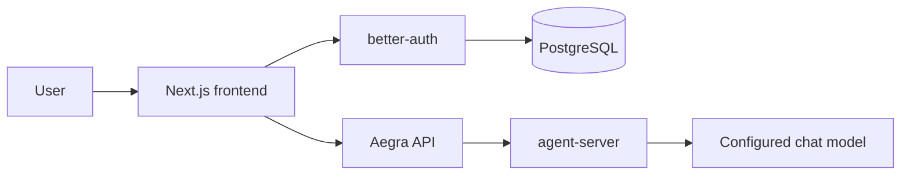

# Mit-KI Architecture

Mit-KI is a web application for chatting with AI models. The repository is a
small monorepo: the Next.js user interface lives in `frontend/`, while the
agent server lives in `backend/agent-server/`. The server can host multiple
AI agents; `mitki` is one of those agents.

This document describes the current implementation. Planned services are
marked explicitly rather than being presented as already deployed.

## Repository layout

```text
mit-ki/
├── frontend/                 # Next.js web application (better-auth + Prisma)
│   ├── app/                  # App Router routes and layouts
│   ├── components/           # Chat, sidebar, settings, search, and UI components
│   ├── data/                 # Static application data and fixtures
│   ├── hooks/                # React hooks
│   ├── lib/                  # auth.ts (better-auth), auth-client.ts, prisma
│   ├── prisma/               # Prisma schema and migrations (auth tables)
│   └── public/               # Static assets and provider images
├── backend/
│   ├── agent-server/         # Aegra/LangGraph agent service
│   │   ├── src/              # Agent graph and application code
│   │   ├── aegra.json        # Graph configuration
│   │   ├── pyproject.toml    # Python dependencies and package metadata
│   │   └── docker-compose.yml # Current local agent/PostgreSQL/Redis stack
│   └── mcp-server/           # MCP server
├── observability/            # Proposed home for observability services/config
│   ├── langfuse/             # Move Langfuse setup/configuration here
│   ├── prometheus/           # Planned metrics collection configuration
│   └── grafana/              # Planned dashboards and provisioning
├── deploy/                   # Proposed deployment configuration
│   ├── compose.yaml          # Planned whole-stack Compose deployment
│   └── caddy/                # Planned reverse proxy and HTTPS configuration
├── .env.example              # Example settings; never store real secrets here
├── architecture.md           # This document
└── .gitignore                # Repository-wide ignore rules
```

## System overview



The `observability/` and `deploy/` directories describe the intended target
layout; they are not yet fully implemented. Langfuse is currently under
`backend/langfuse/`, and the agent Compose file is under
`backend/agent-server/`. Consolidate whole-stack deployment in
`deploy/compose.yaml` when implemented, retaining a separate development
setup only if it remains useful.

- **Authentication:** better-auth runs inside the Next.js app and persists
  users and sessions in the `postgres` database via Prisma.
- **Databases:** two databases on one PostgreSQL instance — `postgres` for
  better-auth (frontend) and `agent_server` for Aegra (backend). See
  *Data and infrastructure → PostgreSQL*.
- **Local commands:** run `npm install`, then `npm run dev` from `frontend/`.

## Frontend

- **Technology:** Next.js `16.3.4`, React `19`, TypeScript, Tailwind CSS,
  shadcn-style UI components.
- **Authentication:** [better-auth](https://www.better-auth.com/) `^1.7.5`
  with the Prisma adapter (`frontend/lib/auth.ts`), email/password enabled.
  Client-side helpers live in `frontend/lib/auth-client.ts`; types in
  `frontend/types/auth.ts`.
- **Database access:** Prisma `^7` with the `@prisma/adapter-pg` driver.
  Schema in `frontend/prisma/schema.prisma` defines the better-auth tables
  (`user`, `session`, `account`, `verification`).
- **Routing:** Next.js App Router under `frontend/app/`.
- **Main areas:** chat, images, library, projects, scheduled items, settings,
  search, and the application sidebar.
- **Local commands:** run `npm install`, then `npm run dev` from `frontend/`.

## Backend agent server

`backend/agent-server/` is the Aegra service. Its Compose/service name is
`agent-server`; it hosts the `mitki` AI agent, whose LangGraph graph is
currently registered as `mitki_agent` in `src/mitki_agent/graph.py`. Keep the
service name (`agent-server`) distinct from the agent/graph identifier
(`mitki` / `mitki_agent`).

### Request flow

1. `agent-server` (Aegra) invokes the compiled `mitki_agent` graph for the
   `mitki` agent.
2. The `chatbot` node loads the model configured in the runtime context.
3. A system message containing the current UTC time is combined with the
   conversation messages.
4. The model is invoked asynchronously.
5. The response is returned as a graph message.

The graph is intentionally small. `state.py` defines graph state,
`context.py` defines runtime configuration, `prompts.py` stores prompt text,
and `utils.py` contains model-loading helpers.

## Data and infrastructure

### PostgreSQL

The monorepo uses **two separate databases** on the same PostgreSQL instance
(currently a Supabase project), one per application:

| Database        | Owner                    | Managed by        | Tables |
| --------------- | ------------------------ | ----------------- | ------ |
| `postgres`      | Frontend (better-auth)   | Prisma migrations | `user`, `session`, `account`, `verification` |
| `agent_server`  | Backend (Aegra)          | Aegra migrations  | `threads`, `checkpoints`, `crons`, `runs`, `store`, etc. |

Keeping the schemas in separate databases isolates Aegra's migrations and
maintenance sweeps from better-auth's tables. Both databases share the
instance's CPU, memory, and connection limits, so size the instance for the
combined load. When connecting to managed Postgres through PgBouncer, use the
session pooler (or a direct connection) — transaction pooling breaks asyncpg
prepared statements. Set `PGSSLMODE=require` for TLS-terminated endpoints.

The local Compose stack uses `pgvector/pgvector:pg18`. It is the primary
persistent store. The frontend's better-auth tables are managed by Prisma
migrations; the agent server's data is managed by Aegra. When services share
one PostgreSQL instance, give each its own database and credentials (see
Deployment direction).

### Redis

Redis `7-alpine` is configured as the broker/runtime service for the full
Compose stack. It is not currently used as a frontend data store.

### Docker Compose

`backend/agent-server/docker-compose.yml` currently defines:

- `postgres` with a persistent Docker volume;
- `redis` with a persistent Docker volume;
- `agent-server`, built from the backend Dockerfile and exposed on port `2026`.

The services use health checks and environment variables from `.env`. This is
currently the agent/local stack, not the planned whole-application production
deployment.

## Authentication and security

Authentication is implemented with **better-auth** in the Next.js app:

- email/password sign-in, session cookies managed by better-auth;
- users and sessions persisted in PostgreSQL through Prisma;
- trusted origins configured in `frontend/lib/auth.ts` (currently
  `http://localhost:3000`; production origins must be added before deploy).

Security requirements:

- never commit `.env` files or provider keys;
- use HTTPS in deployed environments;
- keep session cookies HTTP-only, secure, and appropriately scoped;
- validate all client input at the backend boundary;
- restrict CORS/trusted origins to known frontend origins;
- use least-privilege credentials for databases, brokers, and model providers.

Production TLS and hardened session configuration are not yet fully
implemented in the current scaffold.

## Deployment direction

The intended deployment model is:

- deploy the frontend independently, such as on Vercel;
- deploy the backend agent and stateful services on a VPS or managed hosting;
- use `deploy/compose.yaml` as the planned self-hosted whole-stack entry point;
- place Caddy or Nginx in front of public web services for TLS and routing;
- redeploy the backend automatically from GitHub Actions after pushes to
  `main`.

Langfuse configuration belongs under `observability/langfuse/`; Prometheus
and Grafana configuration belongs under `observability/prometheus/` and
`observability/grafana/`. They are planned observability integrations and are
not yet part of the current checked-in service graph. A shared PostgreSQL or
Redis server may serve multiple services, but use separate application
databases and credentials, isolate Redis workloads where supported, and
include all storage dependencies required by the chosen Langfuse deployment.

## Development and quality checks

Frontend:

```bash
cd frontend
npm install
npx prisma migrate dev      # apply better-auth schema
npm run dev
npm run lint && npm run build
```

Backend:

```bash
cd backend/agent-server
cp .env.example .env
uv sync
uv run aegra dev
```

There are currently no committed frontend or backend test suites. Add tests
when a behavior has enough business logic to justify them, especially around
authentication, persistence, and graph behavior.

## Planned evolution

1. Connect frontend chat flows to the backend agent.
2. Add Celery workers for background jobs where asynchronous work is needed.
3. Add production deployment, TLS, metrics, logging, and LLM tracing.
4. Add automated validation and deployment workflows.
5. Harden better-auth for production: trusted origins, secure cookies, and
   optional OAuth/social providers.

## Ownership boundaries

- `frontend/` owns presentation, browser interaction, client-side state, and
  authentication (better-auth + Prisma).
- `backend/agent-server/` owns agent hosting, model orchestration, and graph
  execution; `mitki` is one hosted agent.
- PostgreSQL owns durable application state, split into two databases:
  `postgres` (better-auth, frontend) and `agent_server` (Aegra, backend).
- Redis owns broker and short-lived runtime concerns.
- Deployment configuration must not leak provider credentials into source code.

Last updated: 2026-09-26
