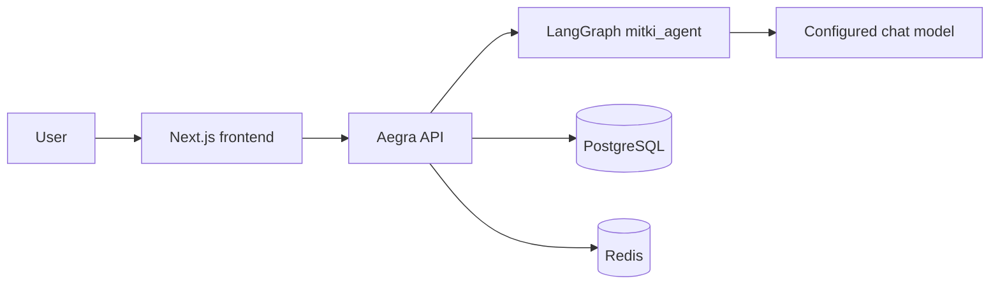

# Mit-KI Architecture

Mit-KI is a web application for chatting with AI models. The repository is a
small monorepo: the Next.js user interface lives in `frontend/`, while the
LangGraph/Aegra agent currently lives in `backend/mitki-agent/`.

This document describes the current implementation. Planned services are
marked explicitly rather than being presented as already deployed.

## Repository layout

```text
mit-ki/
├── frontend/                 # Next.js web application
│   ├── app/                  # App Router routes and layouts
│   ├── components/           # Chat, sidebar, settings, search, and UI components
│   ├── data/                 # Static application data and fixtures
│   ├── hooks/                # React hooks
│   ├── lib/                  # Shared frontend utilities
│   └── public/               # Static assets and provider images
├── backend/
│   └── mitki-agent/          # Aegra/LangGraph agent service
│       ├── src/mitki_agent/  # Graph, state, prompts, context, and model loading
│       ├── aegra.json        # Agent graph registration
│       ├── pyproject.toml    # Python dependencies and package metadata
│       └── docker-compose.yml# Local PostgreSQL, Redis, and agent services
├── architecture.md           # This document
└── .gitignore                # Repository-wide ignore rules
```

## System overview



The frontend renders the chat experience and application shell. The backend
agent receives graph requests, invokes the configured language model, and
returns the response. PostgreSQL and Redis are provided by the backend
Compose stack for persistence and broker-backed runtime features.

## Frontend

- **Technology:** Next.js `16.3.4`, React `19`, TypeScript, Tailwind CSS,
  shadcn-style UI components.
- **Routing:** Next.js App Router under `frontend/app/`.
- **Main areas:** chat, images, library, projects, scheduled items, settings,
  search, and the application sidebar.
- **Current boundary:** the frontend is a presentation layer. Backend API
  integration and backend-owned authentication are planned boundaries, not
  assumptions embedded in the UI.
- **Local commands:** run `npm install`, then `npm run dev` from `frontend/`.

## Backend agent

`backend/mitki-agent/` is an Aegra project exposing the `mitki_agent` graph
defined in `src/mitki_agent/graph.py`.

### Request flow

1. Aegra invokes the compiled `mitki_agent` graph.
2. The `chatbot` node loads the model configured in the runtime context.
3. A system message containing the current UTC time is combined with the
   conversation messages.
4. The model is invoked asynchronously.
5. The response is returned as a graph message.

The graph is intentionally small. `state.py` defines graph state,
`context.py` defines runtime configuration, `prompts.py` stores prompt text,
and `utils.py` contains model-loading helpers.

## Data and infrastructure

### PostgreSQL

The local Compose stack uses `pgvector/pgvector:pg18`. It is intended to be
the primary persistent store for users, sessions, conversations, and agent
data as those features are implemented. The current agent scaffold does not
yet define application tables or Alembic migrations.

### Redis

Redis `7-alpine` is configured as the broker/runtime service for the full
Compose stack. It is not currently used as a frontend data store.

### Docker Compose

`backend/mitki-agent/docker-compose.yml` defines:

- `postgres` with a persistent Docker volume;
- `redis` with a persistent Docker volume;
- `mitki_agent`, built from the backend Dockerfile and exposed on port `2026`.

The service uses health checks and environment variables from `.env`.

## Authentication and security

Backend-owned authentication is the intended design. The planned default is
PostgreSQL-backed, HTTP-only sessions so authentication remains independent of
the Next.js deployment.

Security requirements:

- never commit `.env` files or provider keys;
- use HTTPS in deployed environments;
- keep session cookies HTTP-only, secure, and appropriately scoped;
- validate all client input at the backend boundary;
- restrict CORS to known frontend origins;
- use least-privilege credentials for databases, brokers, and model providers.

Authentication, authorization, and production TLS are not fully implemented
in the current scaffold.

## Deployment direction

The intended deployment model is:

- deploy the frontend independently, such as on Vercel;
- deploy the backend agent and stateful services on a VPS or managed hosting;
- place Caddy or Nginx in front of the backend for TLS and routing;
- redeploy the backend automatically from GitHub Actions after pushes to
  `main`.

Prometheus/Grafana metrics and Langfuse LLM tracing are planned observability
integrations. They are not part of the current checked-in service graph.

## Development and quality checks

Frontend:

```bash
cd frontend
npm run lint
npm run build
```

Backend:

```bash
cd backend/mitki-agent
cp .env.example .env
uv sync
uv run aegra dev
```

There are currently no committed frontend or backend test suites. Add tests
when a behavior has enough business logic to justify them, especially around
authentication, persistence, and graph behavior.

## Planned evolution

1. Add the FastAPI application boundary for authentication and application
   APIs.
2. Add SQLAlchemy models and Alembic migrations for PostgreSQL.
3. Connect frontend chat flows to the backend agent.
4. Add Celery workers for background jobs where asynchronous work is needed.
5. Add production deployment, TLS, metrics, logging, and LLM tracing.
6. Add automated validation and deployment workflows.

## Ownership boundaries

- `frontend/` owns presentation, browser interaction, and client-side state.
- `backend/mitki-agent/` owns model orchestration and graph execution.
- PostgreSQL owns durable application state.
- Redis owns broker and short-lived runtime concerns.
- Deployment configuration must not leak provider credentials into source code.

Last updated: 2026-09-20
